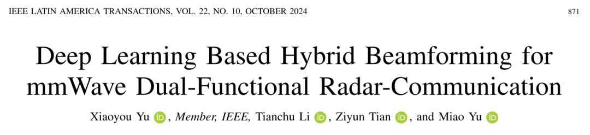
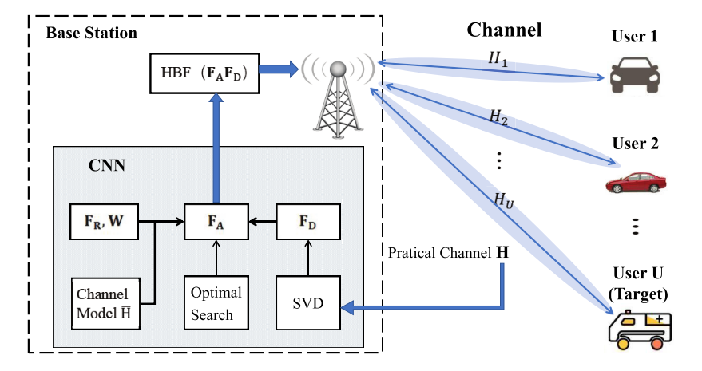
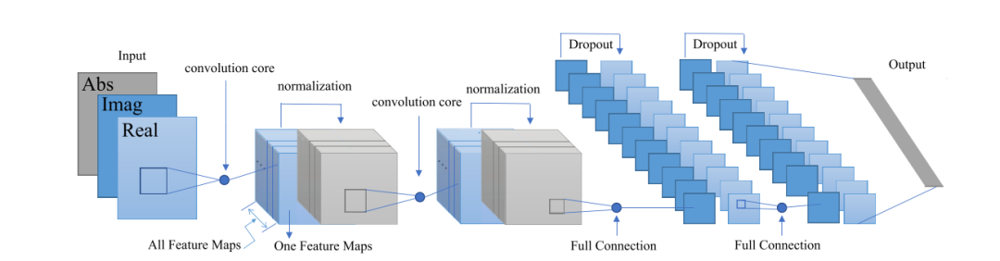
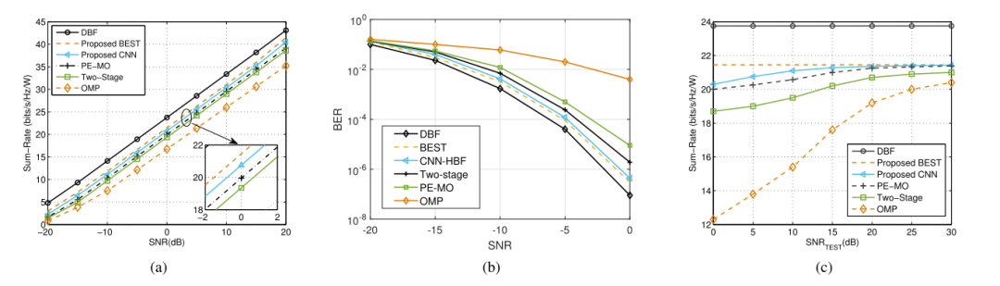
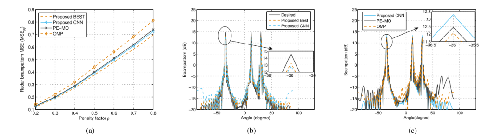
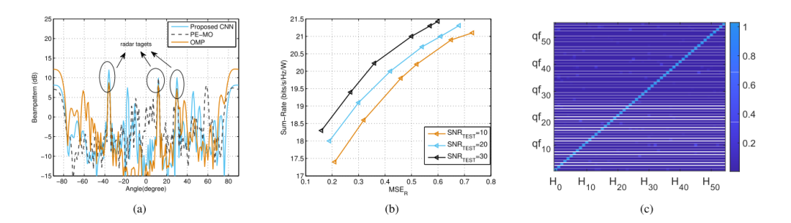
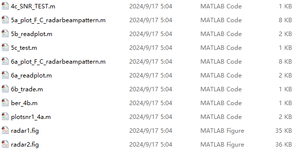

# [BF+ISAC]Deep Learning-Based Millimeter Wave Dual-Function Radar Communication Mixed Beamforming[Join the Group to Get MATLAB Code]

Introduction: The dual-function radar communication (DFRC) system can achieve both cooperative communication and radar perception simultaneously, which is crucial for applications such as Vehicle-to-Vehicle (V2X) in the sixth-generation mobile communications (6G) era. At the same time, as a promising technology for combining radar and communication, HBF has been widely studied to balance the performance of radar and communication ([1], [4], [5]).
For MIMO systems, especially multi-user multiple-input multiple-output (MU-MIMO) systems where base stations communicate with multiple users simultaneously, there have been many in-depth studies on HBF. [6] proposed an evaluation of the performance of related fading channels in an amplify-and-forward (AF) relay assisted MU-MIMO downlink transmission system. [7] proposed two precoding techniques for MU-MIMO dual orthogonal space modulation (DQSM) downlink transmission systems with reconfigurable intelligent surfaces (RIS). Recently, deep learning (DL) with well-trained convolutional neural networks (CNN) has provided new ideas for HBF design in millimeter wave MIMO systems [8]-[11]. Literature [8] proposed a CNN hybrid precoding based on dynamic partial connection (DPC) structure with multi-user optimization algorithm. In [9], an innovative DL hybrid precoding method was developed to maximize spectral efficiency (SE). DL can perform feature learning and hierarchical feature extraction from data/signal sets [10]. However, the DL-based algorithms do not consider radar sensing functionality. Although [11] studied an optimized DL-based method for joint radar and communication (JRC) beamforming to enhance SE for communication users and ensure detection probability of target, this study only considered ideal channel state information (CSI), which is unsuitable in real scenarios [12]. Therefore, it is necessary to seek a low complexity and efficient algorithm.
Based on the above literature analysis, we hope that the DFRC system can be robust to imperfect CSI because in Telecom systems, the channel environment is often such. Additionally, to achieve better HBF design, we tried to improve the performance of the CNN algorithm, including radar sensing as a constraint. Moreover, we aim to enhance the computational speed of the CNN neural network and be able to analyze all possible HBF design combinations based on extensive data analysis. The main contributions of this paper are as follows:
· A new HBF design for the DFRC system is proposed to minimize the sum of the MSEs of multiple users' downlink paths while satisfying good-designed radar beam directional patterns. This scheme closely approximates the performance of an ideal HBF scheme and has a 3dB performance advantage over existing radar communication integrated balanced beam algorithms.
· The HBF design originates from a trade-off optimization with penalties. An effective solution can be achieved through a CNN-based approach using a pre-designed optimal matching search algorithm. Compared to other existing algorithms, the proposed CNN-HBF algorithm provides better improvements in BER and rate and aspects, achieving at least 2 dB SNR improvement and about 1 dB rate and improvement when BER is 10 - 4.
· Using sufficiently large training data to train the CNN, this method is robust to imperfect CSI in channels with low SNR. Compared to other algorithms, it averagely improves rate and performance by 5 dB under low SNR conditions. Furthermore, the introduction of an attention mechanism can reduce computational time by 75% to 80%.
The article includes illustrations:
Figure 1. HBF architecture for V2X in mmWave DFRC.
Figure 2. CNN block diagram for HBF in mmWave DFRC.
Figure 4. (a) Rate vs. SNR, (B) BER based on QPSK modulation, (c) Rate vs. SNRTEST.
Figure 5. (a) Radar beam plot with penalty factor, (B) Radar beam plot with expected value, (c) Radar beam plot compared to other algorithms.
Figure 6. Under the conditions of NT = 64, NRF = NS = 3, (a) Rad-Com compromised beam directional pattern, (B) Rad-Com compromised beam directional pattern MSE MSER with downlink communication and rate, (c) attention mechanism distribution model.
Conclusion: A design of CNN-HBF using DL framework is studied. Simulation results show that under the same bit error rate, this method has at least a 2 dB SNR gain compared to other methods. At the same SNR, this method also improves the sum rate by at least 1 bit/s/Hz/W compared to existing algorithms. When the channel interference power increases, the sum rate remains stable at 20-22 bit/s/Hz/W, and the algorithm has strong robustness against channel interference. The radar communication compromised beam pattern is superior to other algorithms and is closest to the best case. In future work, we can further consider the performance metrics at the radar end, optimize the beam design to adapt to the needs of radar communication applications such as Telematics.
MATLAB code list

## Images

<!-- PAYMENT_BLOCK -->

## Get this dataset

- Payment link (Stripe): [Buy now](https://buy.stripe.com/3cs8yP7sY87d0vu9AB)
- Payment QR code: 

<!-- /PAYMENT_BLOCK -->
